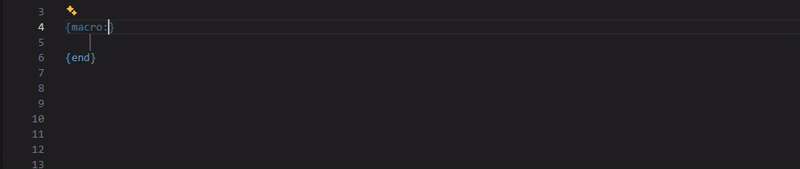

# OMSI Script Language Server

Language server and Visual Studio Code extension for the scripting language of OMSI (`.osc`).

The `OMSIScript.Core` analyzer mirrors the script compiler and interpreter of OMSI 2.3.004. 

## Repository layout

| Path | Content |
|---|---|
| `src\OMSIScript.Core` | Lexer, command classifier, language catalogs, project model, analyzer and IDE features. |
| `src\OMSIScript.LanguageServer` | LSP host on stdio. |
| `tests\OMSIScript.Core.Tests` | Unit tests. |
| `client\vscode` | VS Code extension: language client, TextMate grammar, language configuration and integration tests. |
| `scripts` | `build.ps1` builds, tests and packages for the current platform; `release.ps1` bumps the version and tags a release. |

## Building

Requirements: .NET 10 SDK, Node.js 20+ and the platform's native toolchain for Native AOT.

`.\scripts\build.ps1` runs the tests and produces the native server, VSIX for this machine. `.\scripts\build.ps1 -IntegrationTests` additionally executes the VS Code integration tests. 

The VSIX is written to `artifacts`. For development, open `client\vscode` in VS Code and run the extension host; it uses `artifacts\server\<rid>` when no bundled server exists.

## License

[CC BY-ND 4.0](LICENSE.md)
